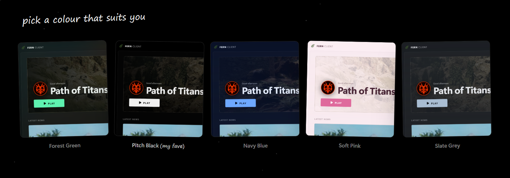
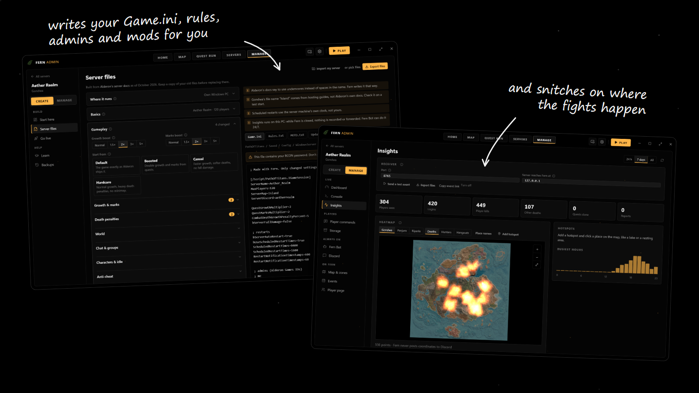

<p align="center">
  
</p>

<p align="center">
  
  
  
</p>

<p align="center">
  <a href="../../releases/latest"><b>Download</b></a>
  &nbsp;&nbsp;·&nbsp;&nbsp;
  <a href="https://fernclient.neocities.org"><b>Website</b></a>
</p>

<br />

Fern is a client for **Path of Titans**. Maps, quest routes, an overlay and server tools, Fern has it all

<br />

## What's in it

| | |
|---|---|
|  | **Maps** Fern supports Gondwa, Panjura and Riparia with 21,000+ resource spots |
|  | **Quest run** Fern calculates quest routes for you |
|  | **Overlay** Fern sits on top of the game while you play |
|  | **News** Fern keeps you up to date with Alderon |
|  | **Servers** Server owners can post their servers on Fern |
|  | **Fern Admin** Fern assists server owners with a variety of things **New in 1.2** |
|  | **Themes** Fern comes with 5 themes |
|  | **Hotkeys** |

<br />

## A little bit of backstory

So you see Fern has a variety of features. So how come you're only hearing about it now?

Fern is, well, recent. I made it for myself and it used to be a simple app. But one day I decided I wanted to expand it, and so I did. Fern is now for everyone to use

<br />

## Quest run

Fern calculates quest runs. Pretty self explanatory, but it plans routes for the player. If you're like me and don't know any resource spots, this feature might be of use to you

<p align="center">
  
</p>

<br />

## Map

<p align="center">
  
</p>

<br />

## Overlay

Overlays only work in windowed or borderless mode

## Home

<p align="center">
  
</p>

<br />

## Themes

Fern comes with 5 themes, because why wouldn't it

<p align="center">
  
</p>

<br />

## For server owners

Fern assists server owners with a variety of things. To access Fern Admin, head over to Settings

> [!NOTE]
> Not for non server owners

<p align="center">
  
</p>

* **Server files** Fern can write your server files for you, or you can import your current ones and go straight to management
* **Go live** and **Learn** for those who have never hosted before
* **Console** for RCON
* **Player commands** like `!heal` or `!discord`
* **Storage** for server storage
* **Fern Bot** keeps it all running 24/7 and connects to Discord
* **Insights** for heatmaps, stats and where fights happen
* **Map & zones** to draw zones your players see on their map
* **Backups**

<p align="center">
  
  
</p>

<br />

## Download

Grab it from [**Releases**](../../releases/latest). **Setup** installs it, **Portable** is a single file. Works on Windows 10 and 11

> [!WARNING]
> Windows might show a blue "Windows protected your PC" screen the first time. It does that for any app without a paid certificate. Click **More info**, then **Run anyway**

<br />

## Hotkeys

| | |
|---|---|
| Show or hide Fern | <kbd>Ctrl</kbd> + <kbd>Shift</kbd> + <kbd>F</kbd> |
| Overlay on or off | <kbd>Ctrl</kbd> + <kbd>Shift</kbd> + <kbd>M</kbd> |
| Move the overlay | <kbd>Ctrl</kbd> + <kbd>Shift</kbd> + <kbd>K</kbd> |

<br />

## Is this a cheat?

No. Fern doesn't read or touch the game, it's basically a map on your second monitor

<br />

## Building

You need [Node.js](https://nodejs.org) and [Rust](https://rustup.rs)

```
npm install
npx tauri build
```

<br />

## Credits

Map data by [**Vulnona**](https://vulnona.com/game/map/). Path of Titans belongs to **Alderon Games**. Fern is a fan project and isn't affiliated with them

<br />

## Contact

Discord: **adibado0**, or post in [Discussions](../../discussions)
