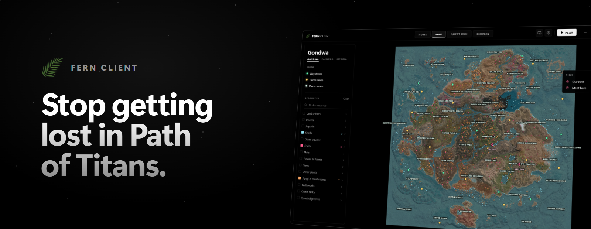
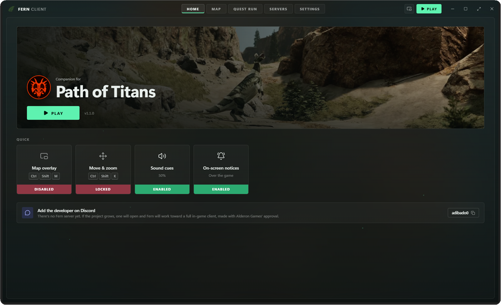
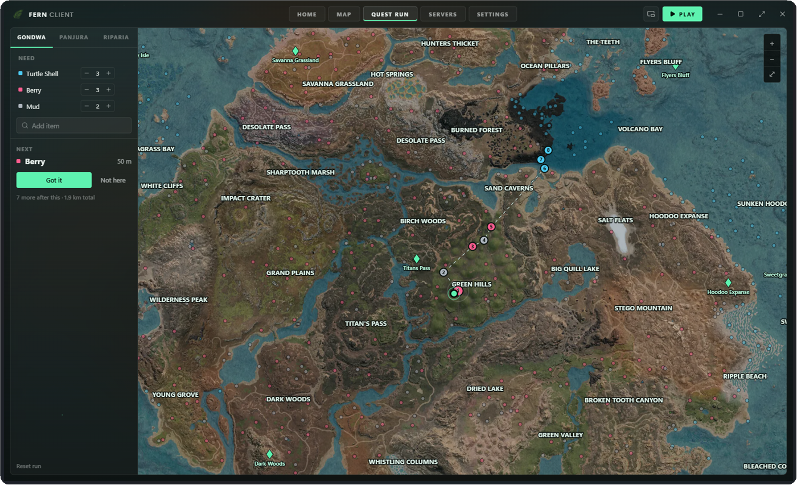
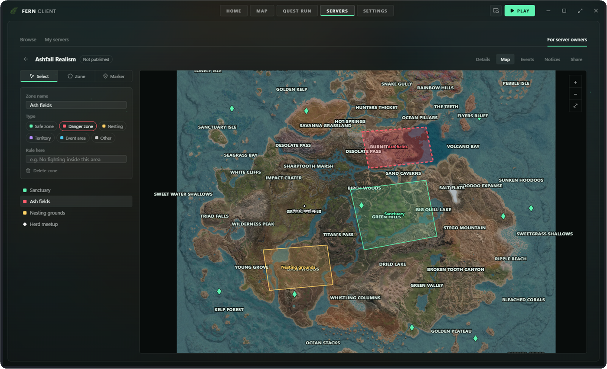

<p align="center">
  
</p>

<p align="center">
  
  
  
</p>

<p align="center">
  <a href="../../releases/latest"><b>Download the latest version</b></a>
  &nbsp;&nbsp;·&nbsp;&nbsp;
  <a href="https://fernclient.neocities.org"><b>Website</b></a>
</p>

<br />

Fern is a small app I made for **Path of Titans** because I was tired of alt tabbing to a browser every time I needed to find something. It keeps the maps, your quest route and your server's info in one place, and it can sit on top of the game while you play.

It's free, it's open source, and it never touches the game.

<br />

## What it does

| | |
|---|---|
|  | **Maps** for Gondwa, Panjura and Riparia with over **21,000 resource spots**, waystones, home caves and place names. Drop your own pins too. |
|  | **Quest run.** Add what your quest needs, click where you are, and Fern plans the **shortest route** to collect it all. |
|  | **Map overlay** that stays on top of the game. Unlock it with a hotkey to move, resize and zoom it. |
|  | **Servers.** Find community servers, add the ones you play on, and see their zones and events on your map. **New in 1.1** |
|  | **Reminders** before server events and a small notice for announcements. Only if you turn them on. |
|  | **Hotkeys** for everything, so you never have to leave the game. |
|  | **Themes.** Forest Green, Pitch Black, Navy Blue, Soft Pink and Slate Grey. |

<br />

<p align="center">
  
</p>

<br />

## Quest run

Quests in Path of Titans usually want a handful of things from all over the map. Tell Fern what you need, click roughly where you are, and it works out the **shortest way** to get everything, not just the nearest spot each time. Hit **Got it** when you grab something and it sends you to the next one.

<p align="center">
  
</p>

> [!TIP]
> Turn the map overlay on while you're doing a quest run. It zooms in on your route so you can follow it without tabbing out.

<br />

## For server owners

Running a community server? Fern lets you put **your server on your players' map**.

<p align="center">
  
</p>

1. **Make a page in Fern.** Draw safe zones, danger zones, nesting grounds and territories, place markers, plan events and post announcements.
2. **Publish it.** Sign in with GitHub once and Fern gives you a link. It costs nothing and only you can change it.
3. **Post the link in your Discord.** Players click it and your server shows up in their Fern, with your zones on their map and overlay. When you publish changes, they get them within a few minutes.

You can also submit your server to the **Fern server list** so new players can find it in the app.

<br />

## Download

Go to [**Releases**](../../releases/latest) and pick one:

| | |
|---|---|
| **Setup** | Installs it with a Start menu shortcut and an uninstaller. Use this one if you're not sure. |
| **Portable** | One file, no install. Put it anywhere and run it. |

Works on **Windows 10 and 11** (64 bit).

> [!WARNING]
> The first time you run it, Windows might show a blue **"Windows protected your PC"** screen. That happens to any app without a paid certificate, it doesn't mean anything is wrong. Click **More info**, then **Run anyway**.

<br />

## Hotkeys

| | |
|---|---|
| Show or hide Fern | <kbd>Ctrl</kbd> + <kbd>Shift</kbd> + <kbd>F</kbd> |
| Map overlay on or off | <kbd>Ctrl</kbd> + <kbd>Shift</kbd> + <kbd>M</kbd> |
| Move and zoom the overlay | <kbd>Ctrl</kbd> + <kbd>Shift</kbd> + <kbd>K</kbd> |

You can change all of them in **Settings**.

> [!IMPORTANT]
> The overlay needs the game in **windowed** or **borderless** mode. Fullscreen draws over everything.

<br />

## Is this a cheat?

> [!NOTE]
> **No.** Fern runs on its own next to the game, like a browser would. It doesn't read, inject into or change Path of Titans in any way. Everything it shows is information that's already public.

<br />

## Building it yourself

<details>
<summary>Show steps</summary>
<br />

You need [**Node.js**](https://nodejs.org) and [**Rust**](https://rustup.rs).

```
npm install
npx tauri build
```

The installer ends up in `src-tauri/target/release/bundle/nsis`.

</details>

<br />

## Credits

* Map data and imagery by [**Vulnona**](https://vulnona.com/game/map/)
* **Path of Titans** and its logo and artwork belong to **Alderon Games**

> [!CAUTION]
> Fern is a fan project and isn't affiliated with or endorsed by Alderon Games. The code is MIT licensed. That doesn't include the map data or any Alderon artwork, those still belong to their owners.

<br />

## Contact

Found a bug or have an idea? Post it in [**Discussions**](../../discussions), or add me on Discord: **adibado0**.

There's no Fern Discord server yet since it's still small. If it grows, one will open up.
