<p align="center">
  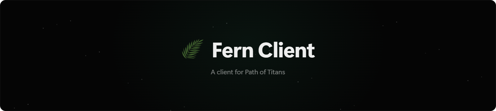
</p>

<p align="center">
  
  
  
</p>

<p align="center">
  
  
  
</p>

<p align="center">
  <a href="../../releases/latest"><b>Download</b></a>
  &nbsp;&nbsp;·&nbsp;&nbsp;
  <a href="https://fernclient.neocities.org"><b>Website</b></a>
</p>

<br />

<p align="center">
  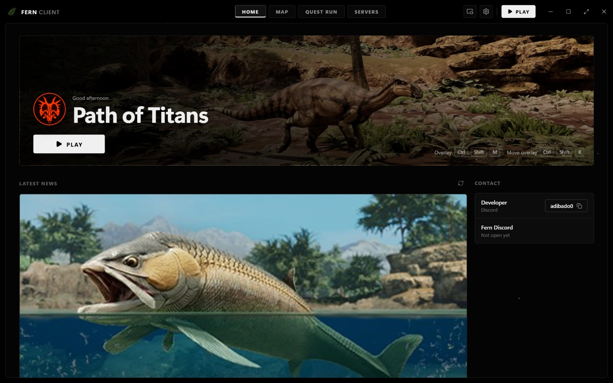
</p>

<br />

## What's in it

* Maps for Gondwa, Panjura and Riparia with 21,000+ resource spots
* Quest routes, Fern calculates them for you
* An overlay that keeps the map on top of the game
* Servers, owners can post theirs on Fern
* Fern Admin, tools for running your own server
* 5 themes

<br />

## Quest run

Add what your quest needs, click where you are and follow the route

<p align="center">
  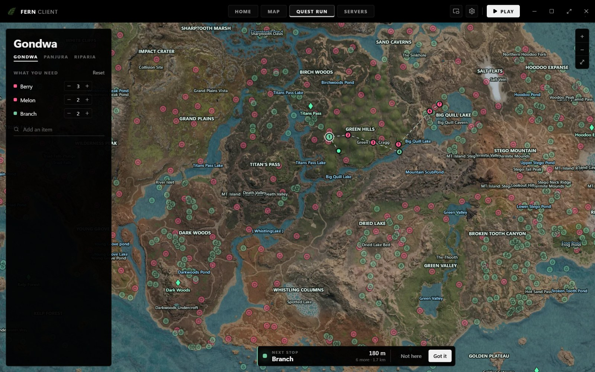
</p>

<br />

## Maps

<p align="center">
  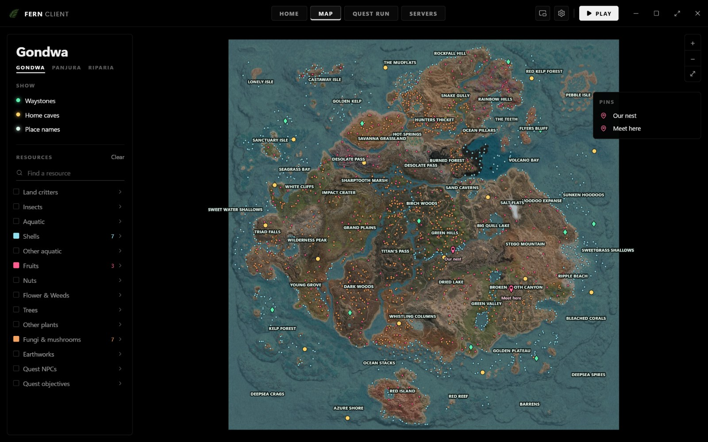
</p>

<br />

## Themes

Forest Green, Pitch Black, Navy Blue, Soft Pink and Slate Grey

<table>
  <tr>
    <td>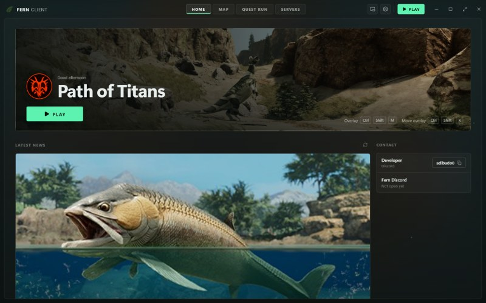</td>
    <td>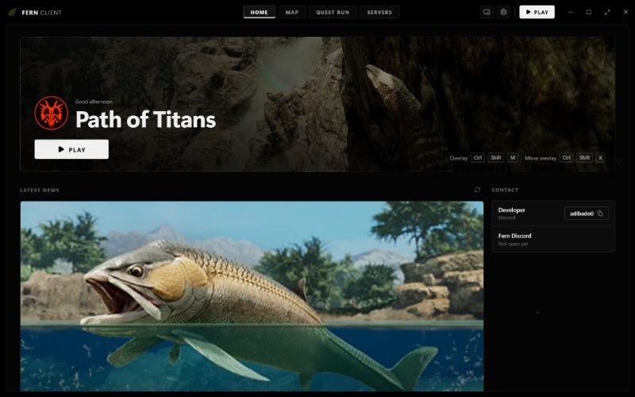</td>
    <td>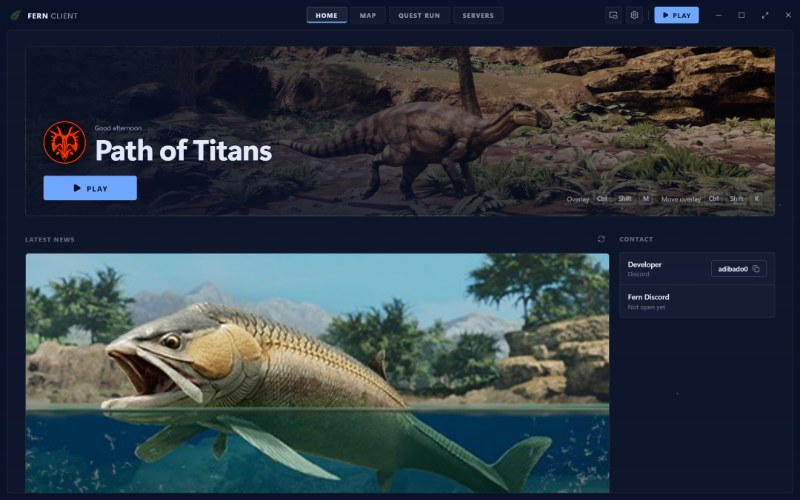</td>
  </tr>
  <tr>
    <td>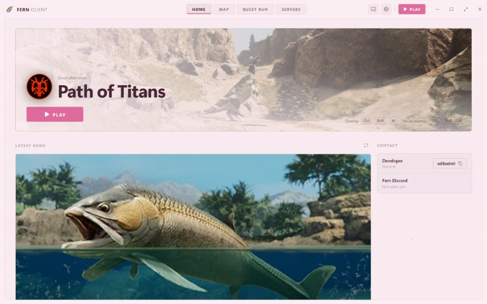</td>
    <td>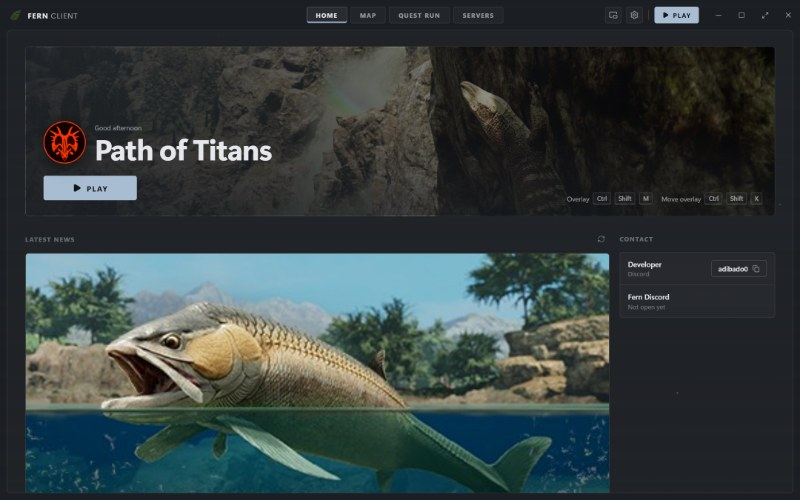</td>
    <td></td>
  </tr>
</table>

<br />

## Fern Admin

For server owners. Turn on **I run a server** in Settings

Fern can write your server files or import the ones you already have, then you manage everything from there: console, player commands, storage, insights, zones and backups. Fern Bot keeps it running 24/7 and connects to Discord

<table>
  <tr>
    <td>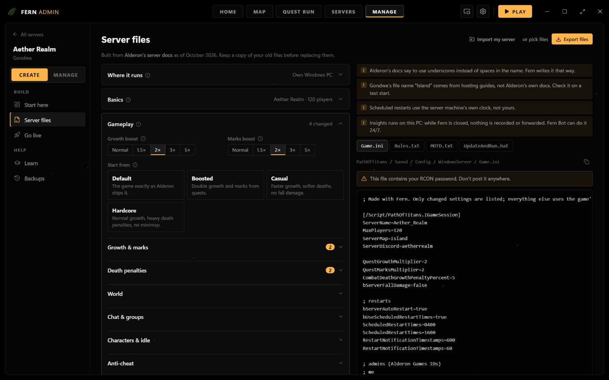</td>
    <td>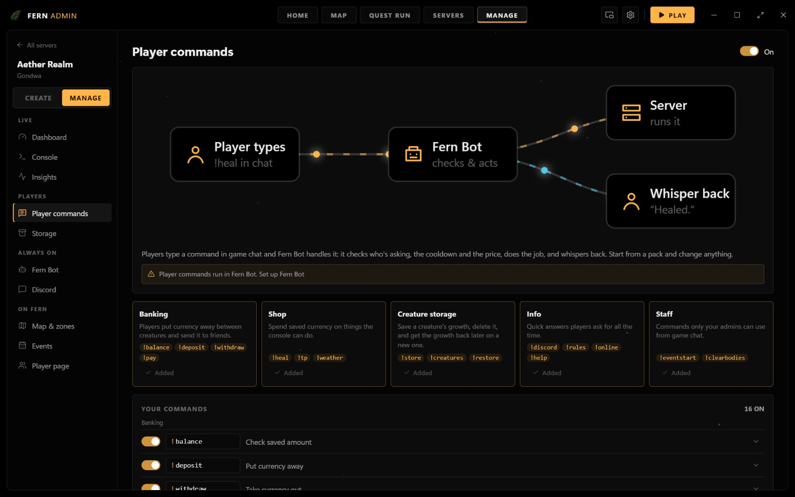</td>
  </tr>
  <tr>
    <td>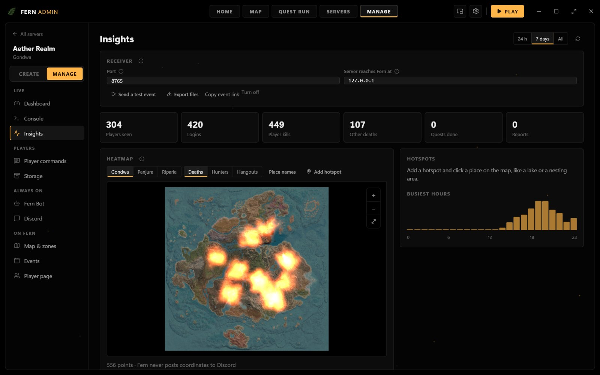</td>
    <td>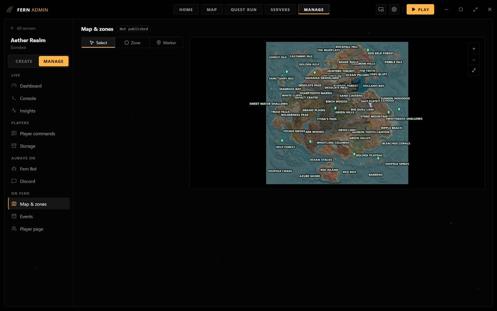</td>
  </tr>
</table>

<br />

## Download

Grab it from [Releases](../../releases/latest). Setup installs it, Portable is a single file. Windows 10 and 11

> [!WARNING]
> If Windows shows "Windows protected your PC", click **More info**, then **Run anyway**. It does that for any app without a paid certificate

<br />

## Hotkeys

| | |
|---|---|
| Show or hide Fern | <kbd>Ctrl</kbd> + <kbd>Shift</kbd> + <kbd>F</kbd> |
| Overlay on or off | <kbd>Ctrl</kbd> + <kbd>Shift</kbd> + <kbd>M</kbd> |
| Move the overlay | <kbd>Ctrl</kbd> + <kbd>Shift</kbd> + <kbd>K</kbd> |

<br />

## Is this a cheat?

No. Fern doesn't read or touch the game, it's basically a map on your second monitor

<br />

## Building

You need [Node.js](https://nodejs.org) and [Rust](https://rustup.rs)

```
npm install
npx tauri build
```

<br />

## Credits

Map data by [Vulnona](https://vulnona.com/game/map/). Path of Titans belongs to Alderon Games. Fern is a fan project and isn't affiliated with them

Discord: **adibado0**
